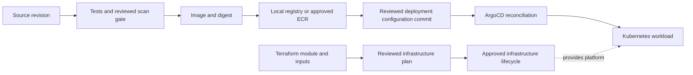
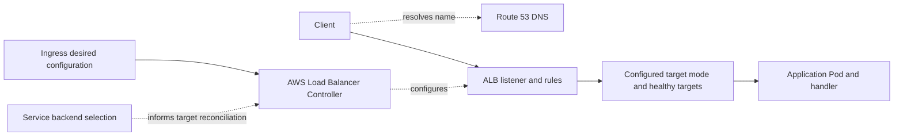
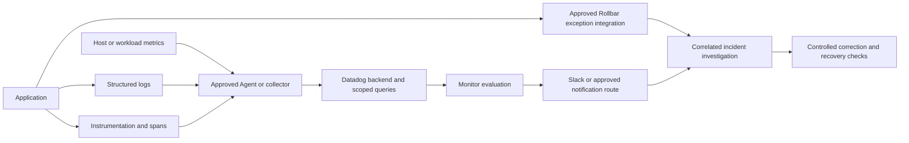

# Five integrated projects

These are personal training projects, not claimed employment. They reuse daily artifacts; they are not five extra weekends hidden inside the 90-minute schedule. A project can remain partly simulated until its optional prerequisites/approval exist.

| Project | Days contributing work | Core deliverable | Optional boundary |
| --- | --- | --- | --- |
| [1. Linux and networking](project-01.md) | 1-4, Docker extension after 6 | Running service, evidence script, layered failure diagnosis | Privileged changes only in the dedicated VM |
| [2. AWS/EKS deployment](project-02.md) | 5, 7-12, 25-26 | Local workload/Service, AWS architecture and EKS incident evidence | Real EKS/ALB uses an explicitly approved paid sandbox |
| [3. Terraform and GitHub Actions](project-03.md) | 13-18, 25 | Local reusable module, state reasoning, test/build workflow, OIDC policy analysis | Real ECR publish and S3 backend need account/repository approval |
| [4. Helm and ArgoCD GitOps](project-04.md) | 19-22, 25 | Chart, environment renders and controlled reconciliation/recovery | Live controller/repo setup may need another session and approved Git access |
| [5. Monitoring and incidents](project-05.md) | 23-24, 26 | Logs, optional local spans, correlated synthetic incident and runbook | SaaS ingestion/notifications require approved accounts and cost review |

Guided procedures are examples. Independent acceptance criteria have no immediate solution. Pick one challenge, write your attempt, use its hint, retry, then consult its separate resolution. The final project record should identify live versus simulated integrations and every untested assumption.

## Architecture reference

These are generic training designs, not verified employer diagrams. Local/simulated boundaries are identified in each project; arrows show different kinds of flow rather than implying every tool carries user traffic.

Delivery and provisioning:

Runtime network path in the AWS reference:

IP targets can address Pod IPs directly; instance targets use the node/NodePort path. This drawing deliberately does not assert that every ALB request traverses a ClusterIP. Readiness, security groups, routes and target health all affect availability.

Telemetry and response:

Local logs, a synthetic dossier, optional local spans and actual backend ingestion are separate evidence levels. No arrow in this reference is a claim that the external integration has been executed.